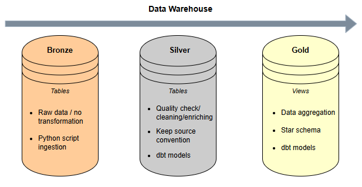

# Sales Analytics Data Warehouse


---

## 🚀 Project Overview

This project implements a **Sales Analytics Data Warehouse** using the Medallion (Bronze/Silver/Gold) architecture, orchestrated with Apache Airflow, transformed with dbt, and fully containerized with Docker. It is designed as an end-to-end data engineering solution for sales data analysis.

- **Business Context:**
  - The warehouse enables analysts to explore sales flows, customer behavior, product performance, and shipping trends for a hypothetical company.
  - Data includes customer purchases, product details, pricing, and shipping dates, supporting a variety of sales analytics use cases.

- **Intended Users:**
  - Data analysts, business intelligence professionals, and data engineers seeking a robust, extensible analytics foundation.

---

## 🏗️ Data Architecture

### Medallion Architecture (Bronze, Silver, Gold)

```mermaid

```

#### **Bronze Layer**
- **Purpose:** Raw ingestion of CSV data into PostgreSQL with minimal transformation.
- **Details:** Data is loaded as-is, preserving original structure for traceability.

#### **Silver Layer**
- **Purpose:** Data cleansing, normalization, enrichment, and validation.
- **Details:**
  - Remove duplicates, handle missing/invalid values, normalize formats, enrich with derived columns.
  - Business logic and data quality checks are applied here (see [Data Quality & Transformation](#data-quality--transformation)).

#### **Gold Layer**
- **Purpose:** Business-ready, analytics-optimized data in a **star schema** (fact and dimension tables).
- **Details:**
  - Fact and dimension tables are created for efficient querying and BI consumption.
  - Supports advanced analytics and dashboarding.

### Data Model: Star Schema: Fact & Dimension Views

- **Fact View:**
  - `fact_sales`: Contains sales transactions, linking to customers and products.
- **Dimension View:**
  - `dim_customers`: Customer attributes (name, demographics, location, etc.)
  - `dim_products`: Product attributes (category, line, cost, etc.)

**Why Star Schema?**
- Enables fast, intuitive analytics for business users.
- Simplifies complex queries and supports scalable BI/reporting.

---

## 🧹 Data Quality & Transformation

- **ELT Approach:** Data is loaded first, then transformed in-database using dbt.
- **Cleansing & Enrichment:**
  - Remove duplicates, trim whitespace, standardize categories, handle missing/invalid values.
  - Derive new columns for analytics (e.g., normalized gender, marital status, correction of calculated sales values following buiseness logic).
  - Enrich data by joining auxiliary tables (e.g., customer demographics, product categories).
- **Validation:**
  - Data quality checks and business rules are implemented in dbt models (see `/dbt_project/models/silver/`).

---

## 🛠️ Technical Stack

- **Python & Pandas:** Ingestion scripts for loading CSVs into PostgreSQL (see `/src/data_ingestion.py`).
- **PostgreSQL:** Data warehouse backend, stores all layers.
- **dbt:** SQL-based transformation, modeling, and documentation (see `/dbt_project/`).
- **Apache Airflow:** Orchestration of ingestion and transformation workflows (see `/airflow/dags/`).
- **Docker & Docker Compose:** Reproducible, isolated development and deployment.

---

## 📂 Project Structure

```
.
├── Dataset/                # Raw CSV data files
├── src/                    # Python ingestion scripts
├── airflow/                # Airflow DAGs and configs
├── dbt_project/            # dbt models, macros, configs
├── docker-compose.yaml     # Multi-service orchestration
├── Dockerfile              # Custom Airflow image
├── requirements.txt        # Python dependencies
└── README.md               # This documentation
```

---

## ⚙️ Orchestration & Workflow

### 1. **Ingestion DAG** (`airflow/dags/ingestion.py`)
- Loads raw CSVs into the **bronze** layer in PostgreSQL.
- Dynamically creates tasks for each table.

### 2. **Transformation DAG** (`airflow/dags/transformation.py`)
- Runs dbt models to transform data from **bronze → silver → gold**.
- Dynamically creates tasks for each dbt model (silver and gold layers).

---

## 🧑‍💻 How to Run the Project

1. **Clone the repository:**
   ```bash
   git clone <your-repo-url>
   cd sales-data-warehouse-airflow
   ```
2. **Configure environment variables:**
   - Copy `.env.example` to `.env` and fill in required values (Postgres, Airflow, etc.)
3. **Start the stack:**
   ```bash
   docker-compose up --build
   ```
4. **Access services:**
   - Airflow UI: [http://localhost:8080](http://localhost:8080)
   - pgAdmin: [http://localhost:5050](http://localhost:5050)
5. **Trigger DAGs:**
   - In Airflow UI, trigger the `Data_ingestion` DAG, then the `Medallion_data_transformation` DAG.
6. **Explore the data:**
   - Query the gold layer tables in PostgreSQL or connect your BI tool.

---

## 📊 Extensibility & Next Steps

- **Add BI/Dashboard Layer:** Connect Power BI, Tableau, or Metabase for interactive dashboards.
- **Enhance Data Quality:** Add more dbt tests, data profiling, or monitoring.
- **Security & Compliance:** Implement data masking, access controls, or audit logging as needed.
- **Automate Scheduling:** Set Airflow DAGs to run on a schedule for production use.

---

## 📸 Diagrams & Visuals

- **dbt Lineage Graph:**
  - _..._ 
- **Airflow DAGs:**
  - _..._

---

## 📬 Contact & About

_This project was developed as a portfolio piece to showcase modern data engineering and analytics architecture. For questions, feedback, or collaboration, please reach out!_

---
